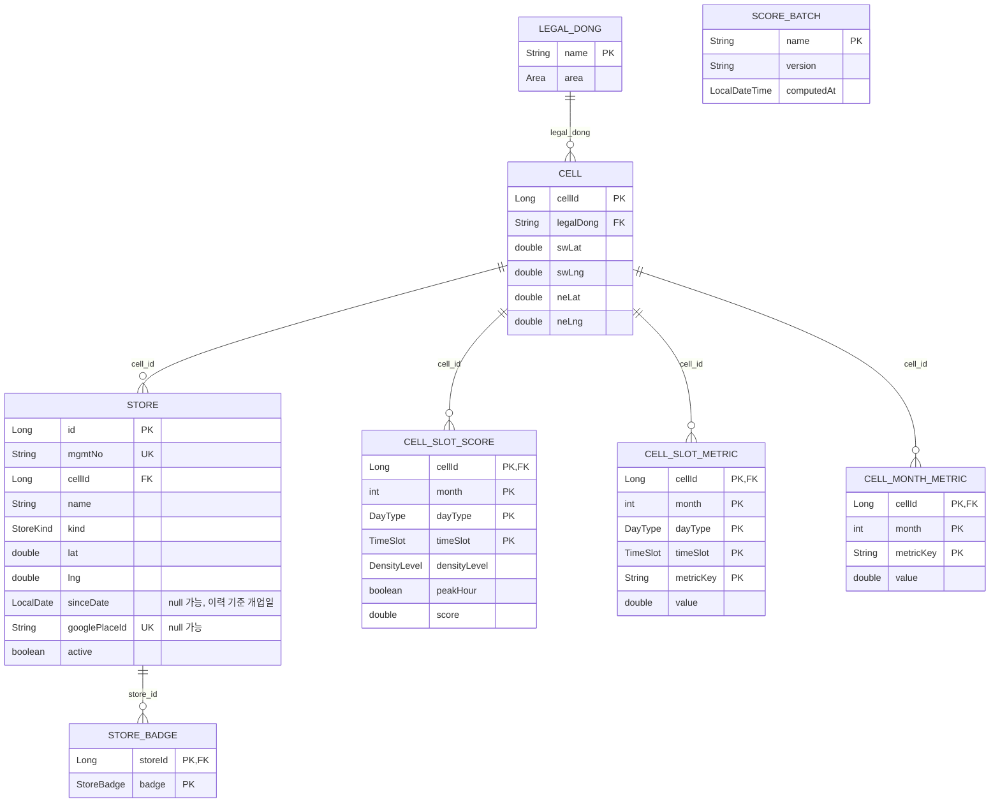

# ERD v3 (V8)

analysis의 v3 CSV를 적재하는 추천 조회 스키마다. 테이블 변경은 BE의 Flyway,
데이터 적재는 analysis의 `load_v3.sql`이 담당한다.

| enum | 값 |
|---|---|
| Area | JONGNO, IKSEON, INSADONG, EULJIRO, MYEONGDONG |
| StoreKind | CAFE, KOREAN, BAR, OTHER |
| StoreBadge | CENTURY_STORE, ORAE_GAGE, FUTURE_HERITAGE |
| DayType | MON_THU, FRI, SAT, SUN |
| TimeSlot | LUNCH, AFTERNOON, DINNER, LATE_NIGHT |
| DensityLevel | LESS_BUSY, MODERATE, LIVELY |

- 지역은 CELL → LEGAL_DONG으로 읽는다. 현재 서비스 범위에서는 법정동 이름을 키로 쓴다.
- 매장은 mgmt_no로 upsert하고 ID를 유지한다. 목록에서 빠지면 active=false다.
- google_place_id는 UNIQUE지만, 적재 중 이관과 비활성 매장 때문에 NULL을 허용한다.
  추천에서는 활성이고 place ID가 비어 있지 않은 매장만 읽는다.
- since_date는 analysis가 인허가 이력을 연결해 만든다. 구 인허가일을 복사하지 않는다.
  노포는 방문일 기준 30년 이상 또는 공식 배지가 하나 이상인 매장이다.
- month는 1~12, score는 0~100의 현지인 방문 인원 순위 백분위다.
  덜 붐빔은 density_level=LESS_BUSY, 활기참은 peak_hour=true로 거른다.
- 지표 value는 0~1이다. 월별 세 지표의 합 1은 적재 과정에서 검증한다.
- 모든 테이블은 RLS를 켠다. BE 엔티티는 읽기 전용이다.

## 전환 시 보관 테이블

V8은 구 CELL_SCORE, CELL_METRIC, CELL_SLOT_SCORE, CELL_SLOT_METRIC을
각각 `*_v1_archive`로 이름만 바꿔 보관한다. 구 컬럼·키·FK·RLS는 유지되며
새 조회나 적재는 사용하지 않는다. 월과 새 요일 구분을 복원할 수 없어 새 점수 표는 비어 있다.
보관 표 삭제는 v3 적재 확인 후 별도 작업으로 한다.

V8은 기존 매장을 비활성화한다. 백업 후 V8과 v3 적재를 한 전환 시간 안에 실행해야 하며,
그 사이 추천은 빈 결과다. 운영 배포 전에 구 place ID 중복을 정리해야 UNIQUE 생성이 통과한다.
