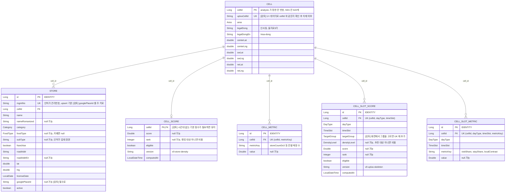

# ERD v1.2

대상: 음식점 · 카페 · 로그인 없음 · 조회 전용 API (2026-10-23 기준)

`[검토]` 는 아직 정하지 않은 것이다. v1.1 에서 바뀐 것은 [아래](#v11-에서-바뀐-것)에 있다.

## enum (`@Enumerated(STRING)`)

| enum | 값 |
|---|---|
| `Area` | `JONGNO` · `IKSEON` · `INSADONG` · `EULJIRO` · `MYEONGDONG` |
| `Category` | `FOOD` · `CAFE` (비알코올 음료 · 빵/도넛 · 떡/한과 · 아이스크림/빙수) |
| `FoodType` | `KOREAN` (한식 · 분식) · `BAR` (주점 · 치킨호프) · `OTHER` |
| `DayType` | `WEEKDAY` · `WEEKEND` |
| `TimeSlot` | `LUNCH` (11~13) · `AFTERNOON` (14~17) · `DINNER` (18~21) · `LATE_NIGHT` (22~01) |
| `DensityLevel` | `LESS_BUSY` · `MODERATE` · `LIVELY` |
| `TargetGroup` [검토] | `DOMESTIC_20S` · `DOMESTIC_30S` · `DOMESTIC_40S` · `FOREIGN` |

## 정한 것

- **BE 는 읽기만 한다.** 적재는 analysis 저장소가 Supabase 에 직접 한다 (`scripts/export/` 는 매장 · 칸, `scripts/uplus/` 는 시간대 점수). 테이블 구조는 BE 의 Flyway 만 바꾼다.
- **Store 는 `mgmtNo` 로 upsert 하고 행을 지우지 않는다.** 목록에서 빠지면 `active=false`. 브라우저에 저장한 매장 id(`localStorage`)가 깨지지 않게 하려는 것이다.
- **점수 · 지표 테이블 4개는 적재 때마다 통째로 교체한다.** 점수 공식이 바뀌면 값과 `version` 만 바뀌고 테이블은 그대로다. 지표를 늘릴 때도 METRIC 테이블에 행만 추가한다. v1.0 은 `foodLq3x3` 처럼 공식이 열 이름에 박혀 있어서 공식이 바뀔 때마다 마이그레이션이 필요했다.
- **시간대 점수는 `CELL_SCORE` 에 열을 늘리지 않고 별도 테이블로 뒀다.** `CELL_SCORE` 는 `cellId` 가 PK 라 칸마다 한 행밖에 담지 못한다.
- **`densityLevel` 은 같은 요일 묶음 · 시간대 안에서의 상대 등급이다.** 활동량 하위 20% 칸을 추천 대상(`eligible`)에서 빼고, 남은 칸을 3등분한다. "덜 붐빔"은 사람이 없는 곳이 아니라 추천 대상 중 하위 3분의 1이다.
- **category 와 foodType 은 상가정보 업종으로 정하고, 짝이 없는 매장만 인허가 업태를 쓴다.** 인허가 업태만 쓸 때보다 실제와 더 잘 맞았다. 수치는 analysis `docs/decision/방향_결정.md`.
- **노포(20 · 30 · 40년 이상)는 `licenseDate` 로 계산한다.** 그래서 열이 따로 없다.
- **area 는 칸의 법정동으로 정한다.** 행정동은 대부분 "종로1·2·3·4가동"이라 구분이 안 된다. 칸의 법정동은 경계 파일 없이 칸 안 상가들의 법정동 다수결로 정한 근사값이다.
- **저장하지 않는 것:** U+ 인구수 원본(비율 지표만 저장), 구글 · 카카오 응답 내용(구글 `place_id` 만 예외), 사용자 정보. 저장 목록과 언어 설정은 브라우저 `localStorage`.

## v1.1 에서 바뀐 것

| 대상 | 변경 | 이유 |
|---|---|---|
| `CELL_SLOT_SCORE` · `CELL_SLOT_METRIC` | 추가 | U+ 인구 데이터로 요일 묶음 · 시간대별 칸 점수와 그 근거 지표를 낸다 |
| `STORE.foodType` | 추가 | 음식점 하위 선택(한식 · 술집) |
| `STORE.verifiedAt` | 삭제 | 카카오 정보는 서비스에 쓰지 않는다. 카카오 결과 저장은 정책상 금지다 |
| `STORE.category` | 출처 변경 | 인허가 업태 → 상가정보 업종 (없으면 인허가) |
| `CELL_METRIC` 의 LQ 키 | 행 삭제 | LQ 분석을 중단했다. 테이블 구조는 그대로 |

## 미정

- 화면에서 그룹(20 · 30 · 40대 · 외국인)을 고르는가: 고르면 `targetGroup` 을 `CELL_SLOT_SCORE` 의 UK 에 넣는다. 지금 analysis 출력에는 이 열이 없다
- 시간대 없는 기본 점수(`CELL_SCORE`)가 계속 필요한가
- 요일을 평일 / 주말로 묶을지, 7일을 그대로 둘지 (`DayType`)
- STORE 의 주 키를 `mgmtNo` 에서 구글 `place_id` 로 바꿀지. 바꾸면 브라우저에 저장된 매장 id 를 어떻게 이어 갈지도 정해야 한다
- `uplusCellId`: U+ 데이터를 받아 `cellId` 와 같으면 삭제
- 명동 칸을 랭킹에 넣을지 (지금 데이터는 포함)
- `nameRomanized` · `roadAddrEn` · `googlePlaceId` 채우는 방법
