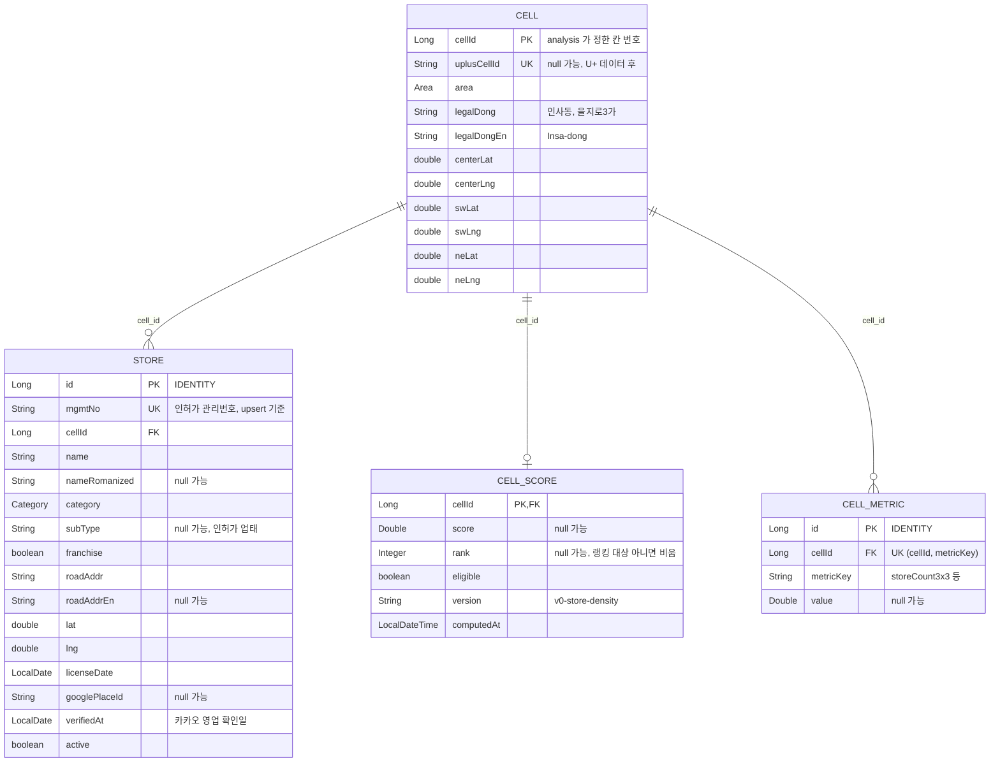

# ERD v1.1

대상: 음식점 · 카페 · 로그인 없음 · 조회 전용 API (2026-10-14 기준)

## enum (`@Enumerated(STRING)`)

| enum | 값 |
|---|---|
| `Area` | `JONGNO` · `IKSEON` · `INSADONG` · `EULJIRO` · `MYEONGDONG` |
| `Category` | `FOOD` (한식 · 양식 · 일식 · 중식 · 아시아 · 분식 · 주점) · `CAFE` (커피 · 디저트 · 베이커리 · 찻집) |

## 정한 것

- **BE 는 읽기만 한다.** 적재는 analysis 저장소(`scripts/export/`)가 Supabase 에 직접 한다. 테이블 구조는 BE 의 Flyway 만 바꾼다.
- **Store 는 `mgmtNo` 로 upsert 하고 행을 지우지 않는다.** 목록에서 빠지면 `active=false`. 브라우저에 저장한 매장 id(`localStorage`)가 깨지지 않게 하려는 것이다.
- **CellScore · CellMetric 은 적재 때마다 통째로 교체한다.** 점수 공식이 바뀌면 값과 `version` 만 바뀌고 테이블은 그대로다. 지표를 늘릴 때도 CellMetric 에 행만 추가한다.
- **점수 계열을 테이블 2개로 줄인 이유** (v1.0 은 CellStoreStat · CellScoreSummary · CellScore 3개): v1.0 은 `foodLq3x3` 처럼 공식이 열 이름에 박혀 있어서, 공식이 바뀔 때마다 마이그레이션이 필요했다.
- **area 는 칸의 법정동으로 정한다.** 행정동은 대부분 "종로1·2·3·4가동"이라 구분이 안 된다. 칸의 법정동은 경계 파일 없이 칸 안 상가들의 법정동 다수결로 정한 근사값이다.
- **저장하지 않는 것:** 구글 · 카카오 응답 내용(구글 `place_id` 만 예외), 사용자 정보. 저장 목록과 언어 설정은 브라우저 `localStorage`.

## 미정

- 명동 칸을 랭킹에 넣을지 (지금 데이터는 포함)
- `nameRomanized` · `roadAddrEn` · `googlePlaceId` 채우는 방법
- 시간대별 점수는 U+ 데이터가 오면 별도 테이블로
