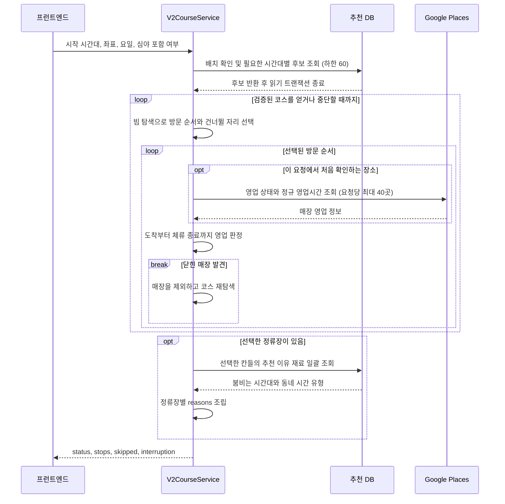

# 코스 추천

`GET /api/v2/course-recommendations`는 시작 좌표와 요일을 받아 최대 여섯 곳의 코스를 계산한다. `/api/v2/recommendations`는 한 구간의 전체 후보 목록을 제공한다.

```http
GET /api/v2/course-recommendations?datasetId=2025-11-fb0c7971545f&weekday=fri&startSlot=dinner&lat=37.5655342&lng=126.9903373&seed=7
```

## 일정

| 자리 순번 | 시간대 | 도착 | 종류와 체류 시간 | 포함 조건 |
|---|---|---|---|---|
| 1 | lunch | 12:00 | 한식 50분 | 필수 |
| 2 | afternoon | 14:00 | 카페 80분 또는 쇼핑 30분 (`afternoon=shop`) | 필수 |
| 3 | afternoon | 15:40 | 놀거리 60분 또는 쇼핑 30분 | 선택 |
| 4 | dinner | 18:00 | 한식 60분 | 필수 |
| 5 | dinner | 19:30 | 놀거리 60분 | 선택 |
| 6 | late_night | 22:00 | 주점 70분 | `lateNight=true`일 때 선택 |

논문 4.7절의 Google 표본 30곳에서 저녁 둘째 자리에 주점도 허용했을 때 23곳이 완주했다. 주점이 연속으로 나오면서 심야에 갈 곳이 줄어 5번 자리는 놀거리만 받는다. 논문에서 필수 세 곳을 채운 경우는 30/30, 여섯 곳을 모두 채운 경우는 25/30이었다. 이 수치는 설계에 사용한 표본 결과다.

`startSlot`은 해당 시간대의 첫 자리부터 시작한다. `lateNight`를 생략하거나 false로 보내면 6번은 `stops`와 `skipped` 양쪽에서 빠진다. 이때 `startSlot=late_night`이면 두 목록이 비고 상태는 `COMPLETE`다.

## 고르는 방식

월~금 3번 자리의 방문 백분위 하한은 60, 다른 자리는 75다(논문 3.3절). 첫 매장은 출발 좌표에서 300m 안에서 고른다. 이후 기본 구간은 직전 매장에서 150~500m이고, 그보다 앞서 들른 매장과도 100m 이상 떨어져야 한다. `walk=short`는 구간 반경 300m만 적용한다. 두 방식 모두 이미 고른 매장과 요청의 제외 ID는 다시 고르지 않는다.

빔 탐색은 매 자리에서 여러 경로를 이어 보고 정류장 수가 많은 순, 점수 합이 높은 순, 총 직선거리가 짧은 순으로 최대 300개 경로를 남긴다. 각 출발점에서 종류·백분위·거리 조건을 통과한 매장은 최대 30곳까지 비교한다. 선택 자리는 갈 수 있는 매장이 있어도 건너뛴 경로를 함께 남겨 뒤의 필수 자리까지 비교한다.

마지막에는 정류장 수가 가장 많은 경로 중 최고 점수 합에서 정류장 수 × 3점 이내인 경로를 모은다. 이 중 최단 경로보다 100m까지 긴 경로도 포함해 `seed`로 하나를 고른다. 논문 4.8절의 Python 오프라인 실험에서 요청당 계산 시간은 약 0.1~0.3초였다. Google 조회와 Java 서버 응답 시간은 해당 측정에 포함되지 않았다.

- **3점**: 2025년 12개 배치에서 90점 이상 칸의 인접 월 백분위 변화는 중앙값 1.3점, 75%가 2.8점 이내였다. 이 안의 차이는 달마다 뒤바뀌는 수준이라 순위로 구분하지 않는다. 사용자 반응으로 검증한 값은 아니다.
- **1위 고정을 버린 이유**: 같은 출발점·조건이면 매번 같은 코스가 나왔다. 을지로 토요일 저녁은 무작위 출발점 30개 중 15개가 같은 두 곳으로 이어졌다.
- **seed**: 같은 seed는 같은 순서로 후보를 확인한다. 영업 확인 결과가 바뀌면 같은 seed도 결과가 달라질 수 있다. 없으면 서버가 정해 응답에 담는다. "다른 코스 보기"는 seed만 바꾼다.

## 영업 확인

응답 시점에 Google Place Details(New)로 `businessStatus`와 정규 영업시간을 조회해 위 일정의 도착부터 체류가 끝날 때까지 계속 영업하는지 본다. 마감 정각에 나오는 것은 된다. 정책상 결과는 저장하지 않는다.

- **체류 시간**: 통계청 생활시간조사 2024 원자료로 20·30대가 기타 실내 한 곳에 이동 없이 머문 구간의 가중 중앙값이다(분석 저장소 `reports/tables/생활시간조사2024_2030_외부체류.csv`, 공표 통계 아님).
- 2026-11-20에 만든 검증 CSV(141곳)는 외부 조회 결과를 파일에 저장했고 매장을 늘릴 때마다 재검증·재배포가 필요했다. 이후 요청 시점 조회로 바꿨다.
- **영업 조회 상한**은 요청 전체에서 40곳이다. 경로 순서대로 확인하다 닫힌 매장을 만나면 그 매장을 제외하고 처음부터 다시 탐색한다. 같은 Google 장소 ID는 한 요청에서 한 번만 조회하며, 다른 도착 시각에 다시 만나면 받아 둔 영업시간으로 새 체류 구간을 판정한다. 요청이 끝나면 조회 결과를 버린다.
- **트랜잭션 밖에서 확인**: 후보 조회는 시간대 기준이라 출발점과 무관하다. 코스에 필요한 시간대의 후보를 한 트랜잭션에서 먼저 다 읽고, Google 확인은 그 뒤 트랜잭션 밖에서 한다. 확인하는 동안 DB 커넥션을 잡고 있으면 동시 요청에 커넥션 풀이 마를 수 있다.
- **FE에서 확인하지 않는 이유**: 다음 구간이 앞 매장 좌표에 의존해서, FE가 확인하면 구간마다 서버와 Google을 오가야 한다.
- **영업시간이 없는 곳**: 영업 중으로 등록됐지만 정규 영업시간이 없으면 음식점·카페·주점은 건너뛰고, 쇼핑·놀거리는 받아 `hoursUnknown: true`로 표시한다. 인사동 소매 후보의 약 60%가 Google 영업시간이 없었다. 적재 단계에서 영업시간도 없고 카카오에서도 확인되지 않는 쇼핑 매장은 뺐다.
- **확인하지 않는 것**: 공휴일·임시휴무, 그리고 **업종**. 이전 CSV는 Google 유형과 카카오 분류로 업종도 확인했지만 지금은 DB 분류(`kind`)를 그대로 믿는다. 첫 실행에서 DB 분류가 한식인 전통찻집이 점심 한식으로 선택됐다.
- 서버용 키는 `GOOGLE_PLACES_API_KEY`다. 없거나 조회가 실패하면 다음 후보로 넘어가지 않고 `VERIFICATION_UNAVAILABLE`로 해당 자리 확인을 끝낸다. 필수 자리는 중단하고 선택 자리는 건너뛴다. 400은 잘못된 place_id(매장 문제, 건너뜀)와 잘못된 키(`error.details[].reason`이 `API_KEY_INVALID`, 멈춤)가 같은 상태라 본문으로 나눈다.

## 응답과 장소 교체

다시 고를 시간대의 첫 출발 좌표와 `startSlot`, 앞서 담았거나 거절한 매장의 `excludeIds=12,34`를 보낸다. 같은 시간대에 두 자리가 있으므로 그 시간대부터 교체한다. `candidateRank`는 해당 자리에서 제외·무작위 선택을 적용하기 전의 순번이다.

채운 자리는 `stops[].position`, 건너뛴 자리는 `skipped[].position`으로 구분한다. 필수 자리를 채우면 선택 자리가 비어도 `COMPLETE`다. 필수 자리를 채우지 못하거나 조회 상한에서 멈추면 `interruption`에 첫 중단 사유를 담고, 앞에서 고른 곳이 있으면 `PARTIAL`, 없으면 `NO_MATCHES`를 반환한다. 세 상태 모두 HTTP 200이다.

`NO_VERIFIED_MATCH`는 조건에 맞는 후보를 모두 소진했을 때, `CHECK_LIMIT`는 40곳을 확인하고도 새 장소 조회가 더 필요할 때 반환한다. 상한이나 필수 자리의 외부 조회 실패로 중단하면 이미 확인한 정류장만 응답한다. 선택 자리의 외부 조회 실패는 `skipped`에 `VERIFICATION_UNAVAILABLE`로 남기고 그 자리를 뺀 경로를 다시 고른다. 후보가 있는 선택 자리를 코스 전체를 비교한 결과 건너뛰면 `SKIPPED_FOR_ROUTE`다.

## 정류장 시각과 추천 이유

`leaveTime`은 도착 시각 + 체류 시간이고 자정을 넘기면 `00:40`처럼 다시 센다. `walkMinutes`는 직전 출발 위치에서 `max(1, ceil(직선거리 × 1.3 / 67))`분이다(논문 4.7절과 같은 가정, 실제 경로 아님).

`reasons`는 코드와 숫자만 보내고 문장은 FE가 언어별로 만든다. 1차 대상이 외국인이라 서버에 문장을 두지 않았다. 순서는 아래 표 순서로 고정이고 개수는 자르지 않는다(FE가 앞의 둘만 보인다).

| 코드 | 붙는 조건 | 값 |
|---|---|---|
| `LOCAL_TOP` | 항상 | `percent = max(1, round(100 - 칸 방문 백분위))` |
| `OPEN_DURING_STAY` | `hoursUnknown`이 false | `from`(도착), `to`(나오는 시각) |
| `PEAK_NOW` | 그 칸·요일의 가장 붐비는 시간대(막대 100)가 방문 시간대 | 없음 |
| `AREA_TYPE` | 칸에 동네 시간 유형이 있음 | `type`: `late_night`·`weekend_day`·`weekday_day`·`mixed` |
| `SIMILAR_CHOICES` | 1위와 3점 이내 점수대 후보가 2곳 이상 | `count`: 그 점수대 후보 수(고른 곳 포함, 제외한 곳 빼고) |

- **칸 기준**: `LOCAL_TOP`·`PEAK_NOW`·`AREA_TYPE`은 가게가 아니라 **가게가 있는 50m 칸**의 값이다. 같은 칸의 가게는 같은 값을 받는다. "이 가게가 상위 3%"로 쓰면 틀린다.
- **동네 시간 유형**: `cell_area_type`은 분석 배치와 무관하다. 2025년 1~12월 150m 창 NMF로 한 번 정한 값이고 적재 SQL은 analysis 저장소에 있다. 직장·외국인 이름표는 기각했고(논문 4.4절) 직장 비중은 이유에 쓰지 않는다(`visit75-no-worker`).
- **조회 시점**: 붐비는 시간대와 동네 유형은 코스를 다 고른 뒤 고른 칸들로 짧은 읽기 트랜잭션에서 한 번 읽는다. 고를 칸은 Google 확인이 끝나야 정해지고, 확인 중에 DB 커넥션을 잡지 않기 위해서다. 공개 배치는 불변이라 후보 조회와 트랜잭션이 달라도 값이 섞이지 않는다.
- **조회 실패·빈 표**: 이유 때문에 코스가 실패하지 않는다. 조회가 실패하거나 표가 비면 `PEAK_NOW`·`AREA_TYPE`만 빠진다.

## 요청 처리 순서



### FE 표시 문구 예시

아래 값은 가상 응답이다. 실제 배치에 놀거리 후보가 없으면 저녁 놀거리 자리는 비고, 오후 놀거리 자리에는 조건을 통과한 쇼핑 후보가 들어갈 수 있다.

| 응답 조건 | 화면 문구 예시 |
|---|---|
| 금요일 오후, `LOCAL_TOP.percent=3` | 금요일 오후 방문 점수가 상위 3%인 구역에 있어요. |
| `OPEN_DURING_STAY`의 `from=19:30`, `to=20:30` | 정규 영업시간 기준으로 오후 7시 반부터 8시 반까지 머물 수 있어요. |
| 놀거리 정류장의 `hoursUnknown=true` | 등록된 영업시간이 없어요. 방문 전에 확인해 주세요. |
| `skipped`에 3번 `NO_VERIFIED_MATCH`, 다음 정류장이 4번 | 주변에서 조건에 맞는 오후 놀거리를 찾지 못했어요. 다음 일정은 오후 6시 저녁 식사예요. |
