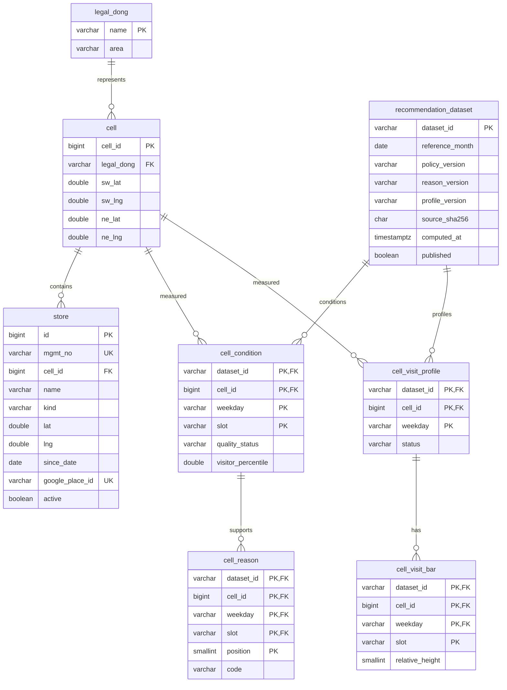

# 최종 v2 ERD와 정규화

추천 API가 사용하는 8개 테이블만 그린다. 기존 서비스의 점수·배지·운영 테이블을 삭제한다는 뜻은 아니다. V1~V8의 기존 마이그레이션 파일명에 있는 v3는 과거 DB 전환 이름이며 이번 HTTP API 버전과 독립적이다.

## 키·형식·NULL·제약

| 테이블 | 후보키 / 함수 종속성 | 비키 속성 / 제약 |
|---|---|---|
| legal_dong | name → area | 대표 법정동 이름 varchar(30), 서비스 area varchar(20), 둘 다 NOT NULL |
| cell | cell_id → legal_dong, 경계 4값 | 셀당 대표 법정동 하나, FK legal_dong.name, 경계 WGS84 실수 |
| store | id → 나머지; mgmt_no → 나머지 | mgmt_no NOT NULL UNIQUE. cell_id FK. kind NOT NULL, lat/lng NOT NULL, active NOT NULL. since_date와 google_place_id는 NULL 가능 |
| recommendation_dataset | dataset_id → 나머지 | varchar(80) PK. reference_month는 월 첫날. 정책·문구·프로필 버전 varchar(80). source_sha256 char(64). computed_at timestamptz. published 기본 false |
| cell_condition | (dataset_id,cell_id,weekday,slot) → quality_status,visitor_percentile | weekday 7종, slot 4종. AVAILABLE일 때만 percentile NOT NULL. 값 0~100. 미관측과 불완전·관측0 구분 |
| cell_reason | (dataset_id,cell_id,weekday,slot,position) → code | position 1~2. 같은 조건에서 code UNIQUE이므로 (조건키,code)도 후보키. 조건키 복합 FK. 허용 코드 7종 |
| cell_visit_profile | (dataset_id,cell_id,weekday) → status | 추천 slot과 독립. 상태 AVAILABLE/INCOMPLETE_TIME_SLOTS/NO_POSITIVE_VISITS/NO_DISTINCT_PEAK |
| cell_visit_bar | (dataset_id,cell_id,weekday,slot) → relative_height | 프로필 복합 FK. slot 4종, relative_height smallint 0~100 |

`store.google_place_id`는 NULL 허용 UNIQUE라 전체 행의 후보키라고 부르지 않는다. 값이 있는 경우에만 외부 식별자로 유일하다. `store.kind` 저장값은 대문자, API는 소문자다. 인허가 관리번호는 내부 정합성·동률 정렬에만 사용하며 공개 응답에는 없다.

## 3NF·BCNF 판단 범위

위 표에 명시한 업무상 함수 종속성에서 모든 비자명 결정자는 해당 관계의 슈퍼키다. 따라서 이 **명시된 종속성 집합에 대해 BCNF, 따라서 3NF**를 만족하도록 구성했다. 아직 확인하지 않은 업무 규칙까지 자동으로 증명한 것은 아니다. SQL 제약이 모든 잠재적 함수 종속성을 발견하는 것도 아니다.

- `cell_id → legal_dong → area`를 한 셀 행에 중복 저장하지 않는다. 기존 legal_dong 관계를 사용한다.
- 배치의 월·정책·출처·생성 시각은 dataset에만 저장한다. 모든 조건·근거·프로필 행에 복제하지 않는다.
- 프로필 반복 그룹을 JSON에서 `cell_visit_bar` 관계로 분해한다. 한 행은 한 시간대 값이다.
- `code + context + 언어`로 만들 문장, `slot → 라벨`, 고정 metric/scale/인구집단은 DB에서 제거한다. 표시 문구는 FE의 버전별 사전에서 조립한다.
- visitor_percentile과 relative_height는 각각 **지역 간 순위**와 **셀 내부 상대 시간 패턴**이다. 계산된 값이라는 이유만으로 같은 종속성으로 묶거나 하나를 다른 하나에서 복원하지 않는다.
- 슬롯·요일 enum마다 설명이 없는 단일 열 사전 테이블을 추가하지 않는다. 정규화 단계는 테이블 개수로 결정하지 않는다.

## 행간 무결성과 공개

PK·FK·CHECK에 더해 배치 공개 시 트리거가 AVAILABLE 프로필의 서로 다른 4시간대와 유일한 100 막대를 확인한다. 비표시 프로필은 막대 0행이어야 한다. 이는 BCNF와 별개인 행간 무결성 규칙이다. 로더는 카탈로그 동일성, 681×28조건 및 681×7프로필 수, 배치 ID 연결, 정책 버전도 검사하고 한 트랜잭션에서 마지막에 published=true로 바꾼다. 교정은 새 datasetId로 적재한다.

정규화 버전은 신규 V9와 V10 마이그레이션으로 구성한다. V10은 이미 격리 검증에 사용한 V9 체크섬을 보존하면서 상수 population 열을 제거한다. 운영 V1~V8을 고치거나 기존 운영 데이터를 삭제하지 않는다. 각 추가 테이블은 RLS를 켜며 브라우저 직접 읽기 정책을 만들지 않는다. API 서버의 DB 역할만 사용한다.
